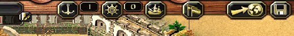
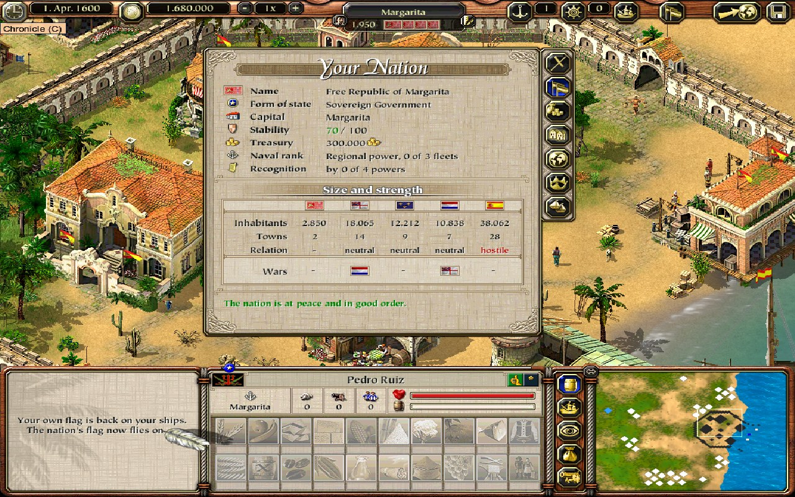
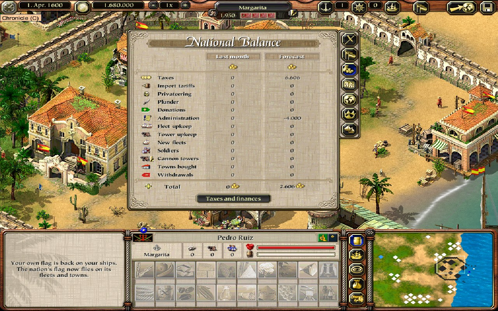
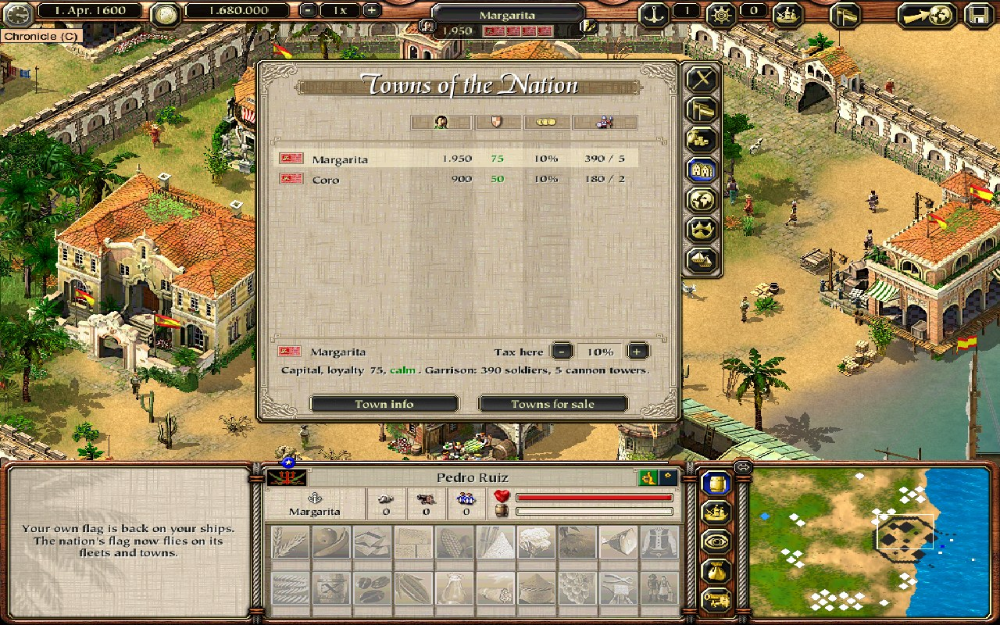
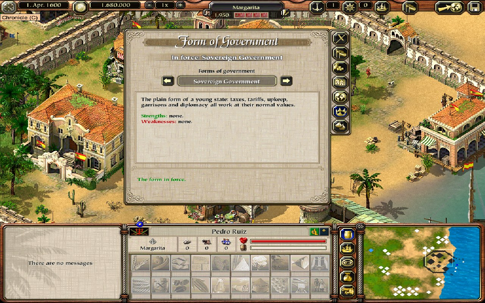
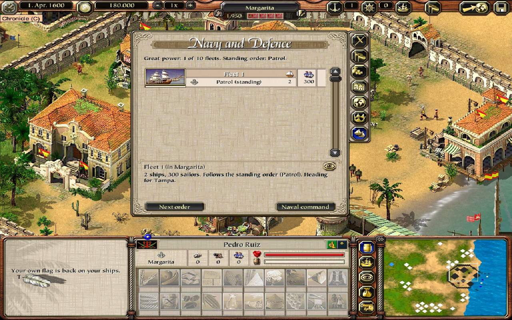
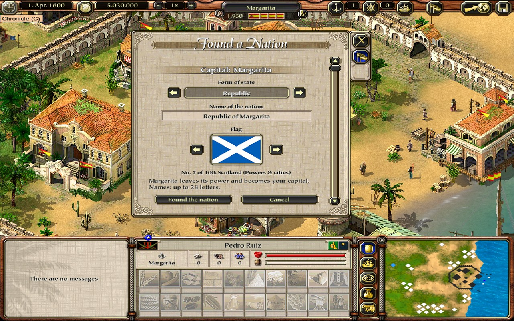

# Sovereign Nations: player guide

This mod lets you found your own nation, a fifth power next to England, France, Holland and Spain. You can grow it by diplomacy and conquest, tax its towns, and keep it alive against the AI powers.

## Install

1. Get the release zip (`SovereignNations_v<date>-<build>.zip`) and extract it to any folder.
2. Double-click **Sovereign Nations Setup**. It finds your Steam copy of Port Royale 2 (1.1.2.3, the
   version Steam sells) by itself; if not, click **Browse** and pick the folder with `PR2.exe`.
3. Click **Install / Update**, then start the game from Steam as always.

The setup never changes `PR2.exe` or your saves, and **Uninstall** puts the game folder back exactly
as it was. `HOW TO INSTALL.txt` in the zip has the details (updates, repair, a black screen on
start). The setup asks before installing next to another mod's loose `towns\*.tow` files, such as
the 4x town mod's: this mod is made and tested with the original towns.

## The nation panel: the nation button

Click the **nation button** in the top bar (the flag icon right of the convoy-list button), or press Ctrl+N, while a game is running and not paused.

- **Before founding**, the nation button (or Ctrl+N) opens the panel on its one page, *Found a Nation*. The town you are viewing becomes the capital; if you are not viewing one, the town of your selected convoy does. The page has everything on one card: the form of state (the arrows step through eight titles), the name (a text box, see below), the flag (the arrows step through all 100 flags, with the flag shown as in the game's new-game logo selector), and *Found the nation* / *Cancel*. If something is missing (gold, ships, property), the card says what.
- **After founding**, the **nation button** in the top bar (the flag icon right of the convoy list; Ctrl+N does the same) opens and closes the **nation panel**: a window like the game's Log / Missions window, with the map running behind it. Its tabs on the right edge (below the close X):

Each tab looks like the game window it resembles:

| Tab | Looks like | What it shows | What you can do |
|---|---|---|---|
| Overview (nation icon) | the Log's *Successes* page and the Chronicle's *Nations* page | name, form of state, capital, stability, treasury, naval rank, recognition; *Size and strength*: inhabitants, towns, relation and wars of the nation next to the four powers; what needs your attention (petitions, offers, unrest, wars, an empty treasury) | — |
| Treasury (gold sack) | the Log's *Balance* page | the national balance in 13 categories (taxes, import tariffs, privateering, plunder, donations; administration, fleet upkeep, tower upkeep, new fleets, soldiers, cannon towers, towns bought, withdrawals): *Last month* and the *Forecast* for this month, with totals | *Taxes and finances* switches to the national tax and the import tariff (arrows), the amount to move (1,000 to 1,000,000) and *Donate* / *Withdraw* (a withdrawal asks first, costs stability, at most half the treasury); *Balance* switches back |
| Towns (buildings) | the Chronicle's *Town list* | one row per member town: flag, inhabitants, loyalty, tax (* = a rate of its own), soldiers / cannon towers. Click a town: its status below | *-* / *+* the selected town's tax (back at the national rate it follows the national tax again); *Town info* opens the game's town window; *Towns for sale* lists towns the nation could buy (price, chance) and a town that asks to join: *Offer …*, *Accept* / *Decline* |
| Diplomacy (globe) | the Chronicle's *Nations* page (relations) | one row per power: flag, treaty, relation, mood. Click a power: recognition, chances and open offers below | the next treaty (*Propose trade*, *non-aggression*, *an alliance*), *Declare war* (asks first); *Offer ceasefire* during a war, *Propose peace* during a ceasefire; *Accept offer* / *Decline* |
| Government (crown) | the new-game settings' value selector | the form in force and the reform cooldown; the arrows browse the five forms with their strengths and weaknesses | *Adopt*, then *Confirm reform* (costs 10 stability, once per 25 months) |
| Navy and defence (ship) | the game's *Convoy list* | *Fleets*: one row per fleet (ship symbol, its order, in port / at sea / in battle, ships, sailors). Click a fleet: where it is and where it is heading. *Naval command*: the standing order, fleets in service, costs and plunder. *Town defence*: soldiers, cannon towers, towers paid by the treasury and recruits on the way per member town | *Next order* / *Next target* and the eye (*Go to*) for the selected fleet; the arrows change the standing order, *Commission*, *Pay off one*; *Recruit* (20,000) and *Build tower* (50,000) for the selected town; the third button switches between the three |

Hover over a button, a column head or a row's symbol to see what it means. The result of every action appears in green (done) or red (not possible, with the reason) on the page. A withdrawal, a declaration of war and a reform ask first: the buttons change to the answer (*Take it* / *Cancel*, *Declare war* / *Cancel*, *Confirm reform*).

- **After a conquest:** when you win a land assault on a town of a power **you are at war with**, a popup asks whether to *Annex* it into your nation or *Withdraw*. A battle won in peacetime gives no title to the town.

News such as founding, wars, unrest and monthly accounts appears in the normal message panel at the bottom left.

## Founding a nation

You need all of the following:

- 5,000,000 gold
- 10 ships, 3 of them warships
- A town that will be your capital. It must hold your own property and must not be a viceroy seat.

When you found the nation, the capital leaves its old power and becomes nation-owned. Its former owner loses reputation with you.

**Building permit.** In every town of your nation you hold the building permit (*Baugenehmigung*) automatically: in the capital from the founding on, and in every other town from the moment it joins, whether by conquest, a fleet's war campaign, purchase or petition. You can build businesses, houses and warehouses there at once (the game's own permit check says so); where you already have property, the town info window lists *Your buildings* instead of your trading record, as for any town where you hold a permit. The join message says so too (*Coro has joined ... You may now build there.*). Towns your nation gained in a save from an earlier version get the permit when you load it. If a town leaves the nation (it secedes or an enemy takes it), the permit goes back to what you had there before it joined: one you had earned yourself stays, one the nation gave you is gone. Your buildings stay either way, as in the original game. The master builder buys a nation town's permit back for nothing, and the nation grants it again the next day. Towns of the colonial powers still need a permit exactly as in the original game.

**The name.** The name box starts with a suggestion from the form of state and the capital, for example *Republic of Margarita*; while you leave it unchanged it follows the form you pick. Type over it to use your own name. Names are up to 28 letters (the box stops taking letters at the limit, earlier for very wide letters, so the name fits the panel title and the town header). Spaces at either end are dropped and an empty name is refused. The forms of state are Republic, Kingdom, Free Republic, Commonwealth, Principality, Confederation, Grand Duchy and Empire.

**Your flag.** Pick one of 100 historical, pirate and Caribbean flags with the arrows beside the flag on the founding card; its number and name are shown under it, and the arrows wrap around from the last flag to the first. Browse them all side by side in the Flag Locker page (`art/flag_locker.html`). The nation's flag is separate from your own flag (the logo you chose at the start of the game). The nation's flag flies on the nation's towns (header bar, town and battle dialogs, the town marker on the sea map) and on its fleets (sails and mast flags in port, their marker on the sea map, convoy lists and the info bar). Your own convoys keep your own flag everywhere, in port and at sea, and the player panel keeps your logo. A ship keeps its flag when it enters or leaves port and after saving and loading. The flagpoles on buildings inside towns still show the former power's flag. In a save from an older version your own logo comes back if the game still has it; otherwise the logo saved in it stays.

You can found only one nation per game.

## Running the nation

**Treasury**
- The treasury is kept separate from your own gold. Fill it with *Donate* and take money out with *Withdraw*.
- It is settled once per game month: towns pay tax, ships passing through your ports pay tariffs, and upkeep is deducted. Upkeep is 2,000 per town (plus the fleets and the cannon towers the treasury bought, see the national navy).

**Tax**
- The default tax applies to every town; you can also set it per town.
- High tax raises income but lowers loyalty.
- A town whose loyalty is below 20 at two month-ends in a row goes on strike. This is real game unrest, in which production stops.
- A town still in unrest 4 months after the outbreak secedes and returns to its former power. The capital never secedes, but it riots and costs stability instead.

**Your towns' officials**
- In the nation's own towns the treasurer, the commander, the governor and the building master serve you as their sovereign. They never refuse you over your reputation with the town's former power (or any other power). They treat you as if your reputation were the highest.
- In other powers' towns your reputation with that power counts as usual.

**Town info of your towns**
- The game's town info window (click the town's name in town, or *Town info* on the Towns tab) of a town of your nation says *Capital of …* or *Town of …* your nation under the name, and its fourth section is **Your nation**: the nation's flag and the town's loyalty as on the Towns tab — *loyal (72)* from 50, *calm (35)* from 20, *restless (18)* below 20 or when unrest is coming, *in unrest* during open unrest. The section follows the town while the window stays open: a change of loyalty shows at once.
- In a power's town the section is the game's own *Your relationship with …* line.

**Stability**
- Stability runs from 0 to 100. It falls with wars, riots and changes of government, and rises in peace.

**Government**
- You can switch government at most once every 25 months. A switch costs 10 stability and needs at least 20 stability. The five types are:

| Government | Strengths | Weaknesses |
|---|---|---|
| Sovereign (default) | balanced | — |
| Merchant Republic | +5% tax efficiency, tariffs ×1.25, powers accept trade and peace more readily | each war costs more stability |
| Colonial Monarchy | garrisons count more, higher stability target | upkeep ×1.25, conquered towns settle slowly |
| Pirate Republic | monthly plunder from every enemy (up to 1,500 gold per warship), wars cost less stability | relations with all powers worse, conquered towns resent you |
| Maritime Federation | +8 town loyalty, unrest only below loyalty 15 | −10% collection, rebels secede after 3 months |

## Growing peacefully

Besides conquest, the nation can gain towns in two peaceful ways:
- **Buying a town.** Every town where you own property (a business or a warehouse) and whose power is not at war with you appears at the end of the *Towns* tab as *Buy <town>*, with its price and the chance its power agrees. The price is 60 gold per inhabitant plus half the town's wealth, double for a governor's seat; viceroy seats are never for sale. *Offer …* pays from the treasury if the power accepts; it likes you a little less afterwards. The answer is a roll that changes daily.
- **Petitions.** At a month end a prosperous town where you own property may ask to join a stable nation (stability 55 or more, treasury not in debt). The request appears at the top of the *Towns* tab with *Accept* and *Decline* and stands until the next month end. An accepted town joins with loyalty 70; its power likes you less.

**Offers from the powers.** When a power offers a trade agreement, or a war-weary enemy offers a ceasefire, its card on the *Diplomacy* tab shows the offer with *Accept offer* and *Decline* while it is open.

## The national navy

Your nation has its own fleets. They are real military convoys under your flag, and the game's own military AI sails them: they lie in your harbours, patrol between your towns, hunt pirates and fight the warships of every power you are at war with. Their battles are fought out automatically, like battles between the AI powers; you only fight yourself when you are there with your own convoy. They never attack your own ships.

**Naval rank.** How many fleets the nation can command depends on its rank. The rank grows with your towns, their population, the treasury and stability:

| Rank | Fleets | Orders |
|---|---|---|
| Fledgling state | 1 | Patrol |
| Regional power | 3 | Patrol |
| Naval power | 6 | Patrol, Raid enemy trade |
| Great power | 10 | Patrol, Raid enemy trade, War campaign |

Score = 12 per town + 1 per 500 inhabitants + 1 per 50,000 gold in the treasury (at most 20) + stability ÷ 10. The ranks start at 30, 60 and 100 points.

**Orders.** One standing order applies to all fleets:
- *Patrol*: the fleets guard your harbours and, while you are at war, strike at weakly defended enemy ports now and then, fighting whatever they meet on the way.
- *Raid enemy trade* (Naval power): a fleet that has lain in port for two days (to repair and re-arm) puts to sea and cruises off a port of a power you are at war with for 20 days, attacking its convoys, merchants and treasure fleets included; then it comes home with its plunder and goes out again. A fleet down to one ship stays home until it is reinforced. A ceasefire or peace with that power ends the raid at once ("Your fleets break off their raids on English shipping"): the fleets never attack a power you are at peace with.
- *War campaign* (Great power): a fleet that anchors at an enemy town attacks it, if it has more sailors than the town has soldiers or more guns than its towers can answer. A won land assault annexes the town to your nation. Viceroy seats cannot be taken.

**Plunder.** What your fleets capture is sold for the treasury when they come home: half the base price of the goods. Their weapons stay on board.

**The enemy's fleets.** A power at war with you sends a war fleet against your towns: one at the start of the war, then at most one every 56 days, as the powers do against each other. It besieges one of your towns; your garrison, cannon towers and any fleet lying in that harbour defend it. A won land assault takes the town back for that power.

**Costs.** A fleet costs 120,000 gold from the treasury to fit out, then 6,000 a month. The monthly accounts show this as *navy and forts*.

**Naval command.** At every month end:
- a fleet that was lost is replaced, if the treasury can pay;
- fleets you chose to pay off leave service;
- if the treasury is insolvent at two month ends in a row, one fleet's crews desert.

If the rank drops (for example because you spent the treasury on ships), you keep your fleets and your order; you just cannot commission more or choose an order the lower rank does not allow.

**The Navy and defence tab** shows the rank, the fleets, the standing order and last month's costs.
- Title bar: *Commission a fleet* (fits out a fleet in the capital) and *Pay off a fleet* (saves its upkeep).
- The order cards: the button on an order your rank allows gives it to every fleet.
- *Fortify* cards: *Build a cannon tower*, 50,000 gold, then 500 a month; at most 10 towers per town.
- On the *Towns* tab: *Recruit soldiers*, 20,000 gold towards new soldiers. They join the garrison over the following days, as far as the town can house them; the rest is refunded.

The game also grows garrisons and towers in your towns by itself, as it does for the powers' towns. Those cost the treasury nothing.

### Seeing your fleets

- **On the map.** Your fleets show on the sea map and the minimap wherever they are, under your nation's flag, and you can watch them sail. On the minimap, national ships are **cyan** dots; your own convoys stay blue.
- **They see for you.** Around each fleet at sea the fog lifts as around your own convoys (the same distance): pirates, merchants and enemy fleets nearby appear on the map and the minimap. This only shows them. You still give orders only to your own convoys, and you can only attack with a convoy of your own that is there.
- **Go to.** Each fleet card on the Navy tab has an eye at the top left. Click it: the panel closes and the sea map centres on that ship (from a town view, the game first switches to the sea map, like pressing a convoy's number key twice). **Ctrl+Shift+N** jumps to the next fleet, one after the other.
- **Orders stay.** The fleets keep their orders and the game's own AI keeps sailing them. The card shows the order, where the fleet is and where it is heading.

The nation's ships are its fleets. Your own convoys always stay yours: they fly your own flag and cost the treasury nothing. (Earlier versions had *national convoys*, own convoys renamed "National convoy N" under the nation's flag for 3,000 a month; they are removed in this version. In a save that has them, each such convoy gets its old name and your flag back when the save is loaded, and nothing is charged for it.)

## Diplomacy and war

Each power keeps a treaty status with you:

- peace
- trade agreement
- non-aggression
- alliance
- war
- ceasefire

You can propose a treaty at any time. The power's answer depends on reputation, relative strength, your government and its current AI strategy, and it can be one of four:

- **Commercial:** values trade.
- **Expansionist:** may attack a weak nation.
- **Defensive:** never declares war.
- **Opportunistic:** strikes when you are weak or insolvent.

A power declares war on you at most once every 180 days. Once its war exhaustion passes 70, it offers a ceasefire.

**No war without a warning.** A power at peace with you never declares war out of the blue. When it starts to consider war, it tells you first and why, for example:

> Holland may declare war on <the player's nation>: relations are unfriendly (-38), and it sees the nation tied up in its war with England.
> Improve relations within a month to keep the peace. Holland's view drifts towards 0 (reputation 90: +20, former sovereign of the capital -20).

Its row on the *Diplomacy* tab then says **threat!**, and the text below names the reason. It may declare war only a month after the warning, if things have not changed. End the other war (a ceasefire is enough), lower your tariff, or win its favour, and the warning lapses: "Tension with Holland eases". It also lapses when the power gets busy elsewhere ("Holland no longer threatens war on ...: it is at war with France now"); if it later considers war again, it warns again first.

**What moves a relation.** Each month a power's relation with you moves 2 points towards a target: half your reputation with it above or below 50, +10 if it recognizes you, the treaty you have, minus half your import tariff, +10 per enemy you share, and -20 if it was the sovereign of your capital before you declared independence (that power also starts at -60). The *Diplomacy* tab shows the target and its parts for the selected power. A conquest, a declaration of war, a broken treaty or a rejected proposal moves it at once.

Your reputation with a power counts: when an action of yours lowers it (attacking its convoys or towns), a message says so, as that power's view of your nation follows it. The nation's fleets never cost you reputation: they only raid powers you are at war with, a raid ends as soon as there is a ceasefire or peace with that power, and they never start a fight with a ship of a power you are at peace with or with one of your own convoys (they still defend themselves when attacked).

**War is real game war.** Your nation's towns become enemies of that power, and you can attack and conquer its towns with the normal coast or harbour attack. Once you win, you choose:

- **Annex:** the town joins your nation. Its loyalty starts low. You hold the building permit there at once.
- **Withdraw:** the town stays with its power.

The game refuses attacks on your own nation's towns.

## Saves

Nation state is saved inside the normal `.pr2` save file and restored when you load. Saves from the unmodded game load normally. In those saves, no nation has been founded yet.

## Scripting and console (advanced)

The whole feature is exposed to the game's Lua as `Nation_*` functions; see the header of [dll/api.c](dll/api.c). While the game runs, you can execute Lua by writing to `PR2Nation.cmd`:

    python tools/console.py "Nation_Log('info', Nation_GetInfo())"

The log is `PR2Nation.log`, next to the exe. It records every change of a power's relation (`REL`) and of your reputation (`REP`) with its cause, every war decision of a power (`AI`), and every sea battle of a national fleet (`BATTLE`), so a war can always be traced back.
