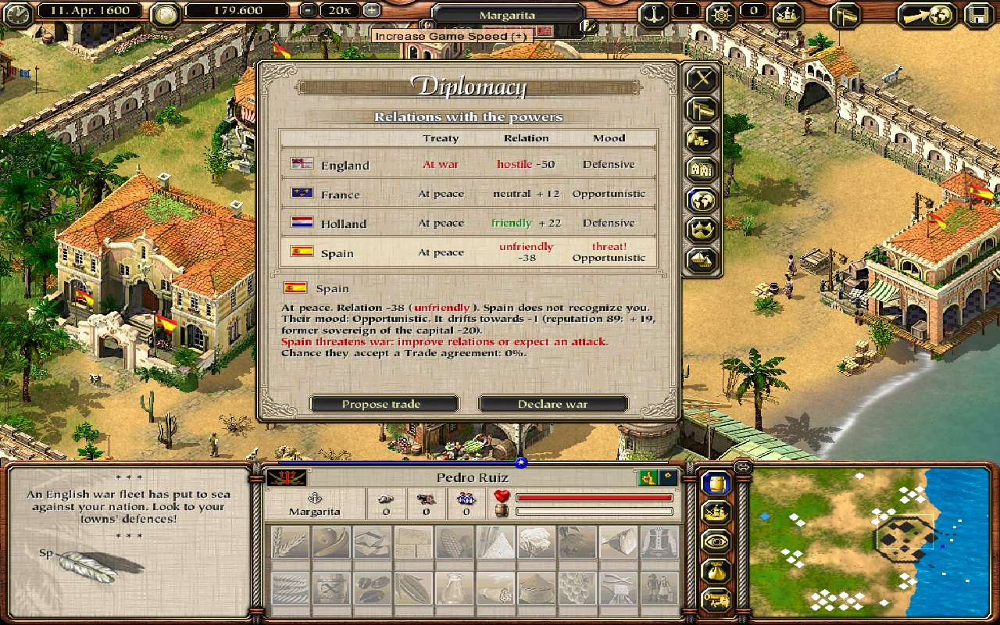
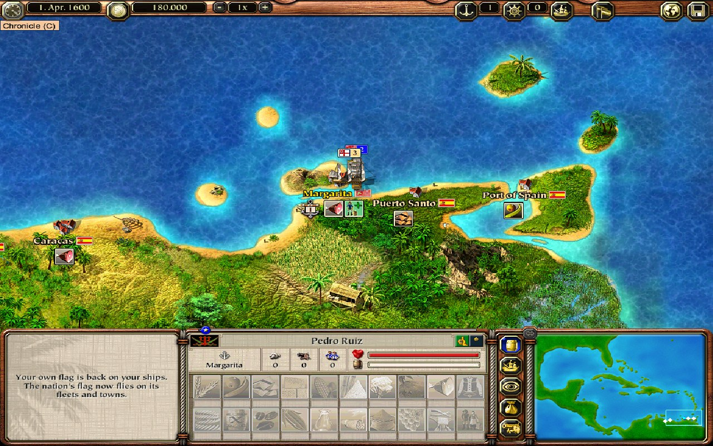

# Sovereign Nations, a Port Royale 2 mod

Found your own nation in the Caribbean, a fifth power next to England, France, Holland and
Spain, and keep it alive. Sovereign Nations is a mod for **Port Royale 2** (Ascaron, 2004; the
Steam release, version 1.1.2.3).

## What the mod does

- **Found a nation** on a town where you own property: it becomes your capital and leaves its
  old power. Pick one of eight forms of state, your own name and one of 100 historical flags.
- **The nation panel** (the flag button in the top bar, or Ctrl+N): Overview, Treasury, Towns,
  Diplomacy, Government, and Navy and defence, each in the look of the game's own windows.
- **Territory**: annex and release towns, loyalty, per-town taxes, unrest and secession.
- **War and diplomacy** with the four powers: treaties, proposals, real wars, ceasefires and
  peace; conquer towns in real land battles and annex them.
- **Economy**: a national treasury with monthly taxes, tariffs and upkeep, kept in 13 categories.
- **Navy and defence**: national fleets the game's own AI sails, standing orders, raids,
  soldiers and cannon towers for member towns.
- **AI and government**: the powers follow strategy profiles; five forms of government with
  their own strengths, reforms and rebellions.
- Everything is stored inside normal save games.

The full list is in [`FEATURES.md`](FEATURES.md), the rules in [`PLAYER_GUIDE.md`](PLAYER_GUIDE.md),
the history in [`CHANGELOG.md`](CHANGELOG.md) and the design in
[`port_royale_2_sovereign_nations_spec.md`](port_royale_2_sovereign_nations_spec.md).

## Screenshots

| | |
|---|---|
|  **Founding:** form of state, name and flag of the new nation. |  **Just founded:** the panel opens on the Overview. |
|  **Overview:** the nation next to the four powers, its wars and what needs attention. |  **Treasury:** 13 categories, last month and the forecast, in the look of the Balance page. |
|  **Towns:** inhabitants, loyalty, tax and garrison per town; towns for sale. |  **Diplomacy:** treaty, relation and mood per power. Spain threatens war, and an English war fleet has put to sea. |
|  **Government:** five forms, each with its strengths and weaknesses. |  **Navy and defence:** the national fleets and their orders. |
|  **A national fleet on patrol** off the capital, under the nation's flag. |  **The nation button** in the top bar opens the panel (Ctrl+N). |

## Install it (players)

You need Port Royale 2 from Steam (1.1.2.3, the version Steam sells) on Windows 10 or 11.

1. Download the release zip (`SovereignNations_v<date>-<build>.zip`) from this repository's
   *Releases* page and extract it to any folder.
2. Double-click **Sovereign Nations Setup**. It finds your Steam copy of the game by itself;
   if not, click **Browse** and pick the folder that contains `PR2.exe`.
3. Click **Install / Update**, then start Port Royale 2 from Steam as always.

The setup never changes `PR2.exe` or your saves. A small loader (`version.dll`) applies the mod
in memory when the game starts, and leaves the game unmodded if it is a build the mod does not
know. **Uninstall** puts the game folder back exactly as it was. Black screen on start (some
Intel graphics)? Run the setup again and tick *Also install dgVoodoo2*.

## Build it (developers)

The repository has the mod's sources and tools and **none of the game's files**. Everything
that is made from the game's own files is built on your machine from your own copy.

You need:

- Windows, Python 3.10 or newer with `pip install pefile capstone Pillow` (and `pyinstaller`
  to freeze the setup into an exe);
- the 32-bit MinGW-w64 GCC from [MSYS2](https://www.msys2.org/) (`pacman -S mingw-w64-i686-gcc`);
  the build scripts look in `C:\msys64\mingw32\bin`, or set `MINGW32_BIN`;
- **the modding kit**, cloned next to this repository (the mod's test and build tools are the
  kit's, not copies of them):

  ```
  git clone https://github.com/dariooo512/pr2-sovereign-nations
  git clone https://github.com/dariooo512/pr2-modkit
  ```

  The tools find the kit as the folder `pr2-modkit` next to this repository; a checkout
  somewhere else is found through the setting `PR2_KIT`. Without the kit they stop and say so;
- your own Port Royale 2 for the steps that need game files.

### 1. The DLL, the loader and the unit tests (no game needed)

```
python dll/build.py           # -> _build/dll/PR2Nation.dll
python loader/build.py        # -> _build/loader/version.dll
python dll/tests/run_tests.py # the nation core's unit tests
```

### 2. The data files, from your own game

The nation panel's screens, the top bar with the nation button and the mission script's
`include.ini` are made from the game's own files, so they are not in this repository. Build
them from yours:

1. Extract the game's `.cpr` archives (`pr2_arcd.cpr`, `pr2_arcs.cpr`, ...) into one folder,
   with each archive in its own subfolder (`arcd/`, `arcs/`, ...). The modding kit's `.cpr`
   extractor does this (its *docs/getting-started.md*, step 6, puts them in the kit's
   `_game/extracted`, where this repository's tools look by default).
2. If they are somewhere else, point `PR2_WORKDIR` at that folder; then run the data build:

   ```
   set PR2_WORKDIR=D:\pr2-extracted
   python tools/build_data.py
   ```

   It runs every screen generator in `art/` (each reads a vanilla screen and writes the mod's
   version to `data/scripts/`), writes `data/lua/config/default/include.ini` as your game's
   own `include.ini` (one line) followed by the mod's mission script `lua/include_body.ini`,
   and makes the 100 flag logos in `data/nation_flags/` from `art/flags_src/`.

These files are build output: `.gitignore` keeps them out of git.

### 3. The patch data and the release

The mod's seven small exe patches (`patches/`) are applied in memory by the loader. Their data
file is built against the DRM-free image of the Steam `PR2.exe` 1.1.2.3 (sha256
`9c9250bc...`), which you make from your own copy (the modding kit's
*docs/techniques/03-the-exe.md* says how):

```
set PR2_BASE_EXE=D:\pr2\PR2.exe.unpacked.exe
python tools/export_patches.py --check    # -> _build/loader/PR2Nation.patches
python tools/release.py                    # -> dist/release/SovereignNations_v<date>-<commit>.zip
```

`release.py` runs the modding kit's release builder (`tools/release/build_release.py`) with this
repository's `install.json`: it builds the DLL, the kit's loader and the patch data, freezes the
kit's setup with PyInstaller when it is installed (with `installer/header.png` in its window), and
refuses to build if any release file is byte-equal to a file of the game (it compares with a test
install and with `PR2_WORKDIR`; `--no-check` skips that).

### Settings

The settings are the modding kit's (its `tools/kit_paths.py`), so the kit and this repository
need one set of them. [`tools/sn_paths.py`](tools/sn_paths.py) finds the kit and gives the mod's
defaults; run it to print every setting, where it comes from and whether the path exists:

| Variable | What | Default here |
|---|---|---|
| `PR2_KIT` | the modding kit's checkout | `../pr2-modkit` |
| `PR2_WORKDIR` | the game's archives, extracted | the kit's `_game/extracted` |
| `PR2_BASE_EXE` | the DRM-free `PR2.exe` 1.1.2.3 | the kit's `_game/PR2.exe.unpacked.exe` |
| `PR2_PRISTINE` | an unmodified copy of the game folder | the kit's `_game/original` |
| `PR2_TEST_ENV` | the disposable test install (`python tools/sn_env.py setup` copies it from `PR2_PRISTINE`) | `%USERPROFILE%\PR2-nation-env` |
| `PR2_TEST_LOCK` | the lock that test runs share | the test install's path + `.lock` |
| `PR2_SAVE_DIR` | the game's Save folder | `Documents\Ascaron Entertainment\Port Royale 2\Save` |
| `PR2_BUILD`, `PR2_BACKUP_DIR` | build output and test logs; the Save-folder backups of the test runs | `_build/`, `_backup/` |
| `MINGW32_BIN` | the 32-bit MinGW GCC | `C:\msys64\mingw32\bin` |

If you followed the kit's *docs/getting-started.md*, its `_game` folder already has your game
files and nothing needs to be set:

```
python tools/sn_paths.py      # PR2_KIT, then every setting, where it comes from and whether it exists
```

The older names `SN_WORKDIR`, `SN_BASE_EXE`, `SN_PRISTINE`, `SN_TEST_ENV`, `SN_TEST_LOCK` and
`SN_SAVE_DIR` still work for now (each prints a one-line note); the `PR2_` name wins.

### Testing in the game

The in-game test tools are the kit's (`tools/test/`: the test install `env.py`, the debugger
host `gamehost.py`, sessions with background input `session.py`, screenshots `screen.py`, the Lua
console `console.py`, hang dumps, keep-awake, mute); its *docs/techniques/07-testing.md* explains
them. This repository adds what is the mod's: `tools/sn_env.py` (the kit's `env.py` with the
mod's files, `deploy BUILT` installs a patched build as `PR2_nation.exe` with the DLL),
`tools/sn_session.py` (the kit's `session.py` waiting for the DLL's log lines, new games at
Margarita), `tools/sn_patch.py` (the kit's `pe_patch.py` with the mod's `.nation` section), and
the suites: the feature suite (`feature_suite.py`), scenario saves (`scenarios.py`), a
real-battle conquest test (`conquest_test.py`) and per-feature probes. They run the game in the
test install, never in your Steam folder.

## Repository layout

| Folder | What |
|---|---|
| `dll/` | `PR2Nation.dll`, the mod (C, about 10,000 lines) and its unit tests (`dll/tests/`) |
| `patches/` | the seven exe patch modules (P01-P07), built with `tools/sn_patch.py` (the kit's `pe_patch.py`) |
| `loader/` | builds the modding kit's loader, `version.dll` (one for every mod; its source and the patch data format are in the kit's `loader/`) |
| `installer/` | the setup's image and HOW TO INSTALL text; the setup is the kit's `tools/release/mod_setup.py` |
| `install.json` | what the release needs, read by the kit's release tools |
| `art/` | the screen generators, the flag sources with their credits, the main image |
| `lua/` | the mod's mission script (`include_body.ini`) |
| `data/` | build output of `tools/build_data.py` (only its README is in git) |
| `research/` | the reverse-engineering notes behind the mod, by topic |
| `tools/` | builds, the release, the test tools |
| `docs/` | the banner, the social preview image and the screenshots (`docs/screenshots/`) |

## The modding kit

The techniques and tools behind this mod (the `.cpr` format, Lua, hooking the exe, the engine
map, testing and debugging) are written up for other modders in
**[pr2-modkit](https://github.com/dariooo512/pr2-modkit)**.

## Credits and licence

- The *Sovereign Nations* artwork (`art/sovereign_nations_thumbnail.png` and its copies) is an
  AI-generated image provided by ferra for the mod, under the repository's MIT licence; see [`art/CREDITS.md`](art/CREDITS.md).
- The 100 flags are from Wikimedia Commons, public domain or CC0; authors per flag in
  [`art/flags_src/CREDITS.md`](art/flags_src/CREDITS.md).
- Code, documentation and the artwork: MIT ([`LICENSE`](LICENSE)). The flags keep their own terms (above).
- Third-party tools and their licences: [`THIRD_PARTY.md`](THIRD_PARTY.md).

Port Royale 2 is a game by Ascaron Entertainment. This project is not affiliated with or
endorsed by its rights holders, and contains none of the game's files.
