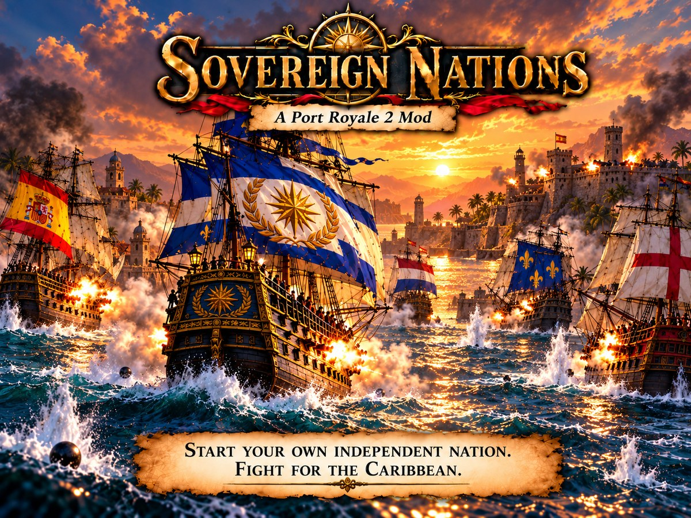

# Sovereign Nations, a Port Royale 2 mod

Found your own nation in the Caribbean, a fifth power next to England, France, Holland and
Spain, and keep it alive. Sovereign Nations is a mod for **Port Royale 2** (Ascaron, 2004; the
Steam release, version 1.1.2.3).

## What the mod does

- **Found a nation** on a town where you own property: it becomes your capital and leaves its
  old power. Pick one of eight forms of state, your own name and one of 100 historical flags.
- **The nation panel** (the flag button in the top bar, or Ctrl+N): Overview, Treasury, Towns,
  Diplomacy, Government, and Navy and defence, each in the look of the game's own windows.
- **Territory**: annex and release towns, loyalty, per-town taxes, unrest and secession.
- **War and diplomacy** with the four powers: treaties, proposals, real wars, ceasefires and
  peace; conquer towns in real land battles and annex them.
- **Economy**: a national treasury with monthly taxes, tariffs and upkeep, kept in 13 categories.
- **Navy and defence**: national fleets the game's own AI sails, standing orders, raids,
  soldiers and cannon towers for member towns.
- **AI and government**: the powers follow strategy profiles; five forms of government with
  their own strengths, reforms and rebellions.
- Everything is stored inside normal save games.

The full list is in [`FEATURES.md`](FEATURES.md), the rules in [`PLAYER_GUIDE.md`](PLAYER_GUIDE.md),
the history in [`CHANGELOG.md`](CHANGELOG.md) and the design in
[`port_royale_2_sovereign_nations_spec.md`](port_royale_2_sovereign_nations_spec.md).

## Install it (players)

You need Port Royale 2 from Steam (1.1.2.3, the version Steam sells) on Windows 10 or 11.

1. Download the release zip (`SovereignNations_v<date>-<build>.zip`) from this repository's
   *Releases* page and extract it to any folder.
2. Double-click **Sovereign Nations Setup**. It finds your Steam copy of the game by itself;
   if not, click **Browse** and pick the folder that contains `PR2.exe`.
3. Click **Install / Update**, then start Port Royale 2 from Steam as always.

The setup never changes `PR2.exe` or your saves. A small loader (`version.dll`) applies the mod
in memory when the game starts, and leaves the game unmodded if it is a build the mod does not
know. **Uninstall** puts the game folder back exactly as it was. Black screen on start (some
Intel graphics)? Run the setup again and tick *Also install dgVoodoo2*.

## Build it (developers)

The repository has the mod's sources and tools and **none of the game's files**. Everything
that is made from the game's own files is built on your machine from your own copy.

You need:

- Windows, Python 3.10 or newer with `pip install pefile capstone Pillow` (and `pyinstaller`
  to freeze the setup into an exe);
- the 32-bit MinGW-w64 GCC from [MSYS2](https://www.msys2.org/) (`pacman -S mingw-w64-i686-gcc`);
  the build scripts look in `C:\msys64\mingw32\bin`, or set `MINGW32_BIN`;
- your own Port Royale 2 for the steps that need game files.

### 1. The DLL, the loader and the unit tests (no game needed)

```
python dll/build.py           # -> _build/dll/PR2Nation.dll
python loader/build.py        # -> _build/loader/version.dll
python dll/tests/run_tests.py # the nation core's unit tests
```

### 2. The data files, from your own game

The nation panel's screens, the top bar with the nation button and the mission script's
`include.ini` are made from the game's own files, so they are not in this repository. Build
them from yours:

1. Extract the game's `.cpr` archives (`pr2_arcd.cpr`, `pr2_arcs.cpr`, ...) into one folder,
   with each archive in its own subfolder (`arcd/`, `arcs/`, ...). The modding kit's `.cpr`
   extractor does this; see [the modding kit](https://github.com/dariooo512/pr2-modkit),
   *docs/techniques/01-game-files.md*.
2. Point `SN_WORKDIR` at that folder and run the data build:

   ```
   set SN_WORKDIR=D:\pr2-extracted
   python tools/build_data.py
   ```

   It runs every screen generator in `art/` (each reads a vanilla screen and writes the mod's
   version to `data/scripts/`), writes `data/lua/config/default/include.ini` as your game's
   own `include.ini` (one line) followed by the mod's mission script `lua/include_body.ini`,
   and makes the 100 flag logos in `data/nation_flags/` from `art/flags_src/`.

These files are build output: `.gitignore` keeps them out of git.

### 3. The patch data and the release

The mod's seven small exe patches (`patches/`) are applied in memory by the loader. Their data
file is built against the DRM-free image of the Steam `PR2.exe` 1.1.2.3 (sha256
`9c9250bc...`), which you make from your own copy (the modding kit's
*docs/techniques/03-the-exe.md* says how):

```
set SN_BASE_EXE=D:\pr2\PR2.exe.unpacked.exe
python tools/export_patches.py --check    # -> _build/loader/PR2Nation.patches
python tools/release.py                    # -> dist/release/SovereignNations_v<date>-<commit>.zip
```

`release.py` builds the DLL, the loader and the patch data, freezes the setup with PyInstaller
when it is installed, and refuses to build if any release file is byte-equal to a file of the
game (it compares with a test install and with `SN_WORKDIR`; `--no-check` skips that).

### Settings

The tools find what is not part of the mod through environment variables
([`tools/sn_paths.py`](tools/sn_paths.py)):

| Variable | What | Default |
|---|---|---|
| `SN_WORKDIR` | the game's archives, extracted | `../reverse-engineering/_workdir` |
| `SN_BASE_EXE` | the DRM-free `PR2.exe` 1.1.2.3 | `../reverse-engineering/_re/PR2.exe.unpacked.exe` |
| `SN_PRISTINE` | an unmodified copy of the game folder | `../original-game/original` |
| `SN_TEST_ENV` | the disposable test install (`tools/env.py setup` copies it from `SN_PRISTINE`) | `%USERPROFILE%\PR2-nation-env` |
| `SN_TEST_LOCK` | the lock that test runs share | `%USERPROFILE%\PR2-nation-env.lock` |
| `SN_SAVE_DIR` | the game's Save folder | `Documents\Ascaron Entertainment\Port Royale 2\Save` |
| `MINGW32_BIN` | the 32-bit MinGW GCC | `C:\msys64\mingw32\bin` |

The `../` defaults are the layout of the workspace the mod was made in (this repository next
to the reverse-engineering folders); in a plain clone, set the variables.

### Testing in the game

`tools/` also has the in-game test tools: a disposable test install (`env.py`), a debugger host
(`gamehost.py`), background input and screenshots (`session.py`, `screen.py`), a Lua console,
the feature suite (`feature_suite.py`), scenario saves (`scenarios.py`), a real-battle conquest
test (`conquest_test.py`) and per-feature probes. They run the game in the test install, never
in your Steam folder. The modding kit's *docs/techniques/07-testing.md* explains the method.

## Repository layout

| Folder | What |
|---|---|
| `dll/` | `PR2Nation.dll`, the mod (C, about 10,000 lines) and its unit tests (`dll/tests/`) |
| `patches/` | the seven exe patch modules (P01-P07), built with `tools/pe_patch.py` |
| `loader/` | `version.dll`, the in-memory loader, and its patch data format (`loader/README.md`) |
| `installer/` | the player setup (`sn_setup.py`, a Tk window) |
| `art/` | the screen generators, the flag sources with their credits, the main image |
| `lua/` | the mod's mission script (`include_body.ini`) |
| `data/` | build output of `tools/build_data.py` (only its README is in git) |
| `research/` | the reverse-engineering notes behind the mod, by topic |
| `tools/` | builds, the release, the test tools |
| `docs/` | the banner and the social preview image |

## The modding kit

The techniques and tools behind this mod (the `.cpr` format, Lua, hooking the exe, the engine
map, testing and debugging) are written up for other modders in
**[pr2-modkit](https://github.com/dariooo512/pr2-modkit)**.

## Credits and licence

- The *Sovereign Nations* artwork (`art/sovereign_nations_thumbnail.png` and its copies) is an
  AI-generated image provided by ferra for the mod, under the repository's MIT licence; see [`art/CREDITS.md`](art/CREDITS.md).
- The 100 flags are from Wikimedia Commons, public domain or CC0; authors per flag in
  [`art/flags_src/CREDITS.md`](art/flags_src/CREDITS.md).
- Code, documentation and the artwork: MIT ([`LICENSE`](LICENSE)). The flags keep their own terms (above).
- Third-party tools and their licences: [`THIRD_PARTY.md`](THIRD_PARTY.md).

Port Royale 2 is a game by Ascaron Entertainment. This project is not affiliated with or
endorsed by its rights holders, and contains none of the game's files.
